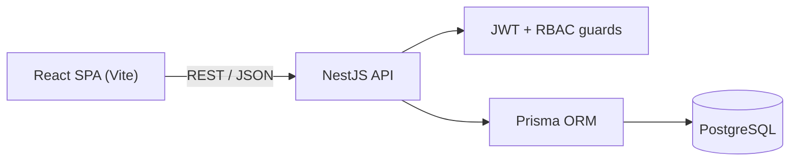

# Learnova

**A full-stack e-learning platform with structured courses, quizzes, timed exams, verifiable certificates and AI-assisted learning.**

[](https://nestjs.com/)
[](https://react.dev/)
[](https://www.typescriptlang.org/)
[](https://www.postgresql.org/)
[](https://www.prisma.io/)
[](LICENSE)

Learnova was built during a summer engineering internship at **Vaerdia** (ISSAT Sousse, 2nd-year engineering cycle).

---

## Overview

Learners browse a catalog of courses, follow sessions step by step, validate each session with a quiz, and earn a certificate by passing a final exam. Each certificate carries a QR code that links to a public verification page. Administrators manage users and content from a dedicated dashboard.

**Catalog:** 108 courses across 14 domains, 142 sessions, 568 videos with lecture notes, 142 practice quizzes and 108 final exams.

## Features

**Learning**
- Course catalog with search and filters by domain, level and access type
- Sequential learning paths: videos unlock in order, and each session unlocks after its quiz is passed
- Embedded YouTube player with automatic completion and tracking of time spent learning
- Markdown lecture notes under every video

**Assessment and certification**
- Practice quiz for each session (70% passing score)
- Timed final exam of 40 questions with a live countdown
- Certificates issued automatically, with a unique number and a QR code for public verification

**AI features**
- Tutor chatbot that detects the question's intent and answers from the course content
- Course recommendations based on each learner's activity and results
- Quiz generator and learner performance analysis

**Engagement**
- Daily streaks, XP points, levels and 35 achievement badges
- Personal dashboard with progress, statistics and recommendations

**Administration and security**
- Admin dashboard to manage users, courses, sessions, videos and quizzes
- JWT authentication, role-based access control (Admin / Learner), bcrypt password hashing
- Rate limiting, Helmet security headers and a password reset flow

## Tech stack

| Layer | Technologies |
| :--- | :--- |
| Frontend | React 19, React Router 7, Vite, Axios, Context API, Lucide icons |
| Backend | NestJS 11, TypeScript, Passport JWT, class-validator, Helmet, Throttler |
| Database | PostgreSQL, Prisma 7 ORM with the `@prisma/adapter-pg` driver |
| Tooling | Docker Compose, ESLint, Prettier, Jest |

## Architecture



The backend is split into feature modules: `auth`, `users`, `courses`, `sessions`, `videos`, `course-content`, `enrollments`, `learning-path`, `progress`, `quiz`, `questions`, `exams`, `certificates`, `gamification`, `dashboard`, `payments` and `ai`.

## Project structure

```text
learnova-platform/
├── backend/            NestJS REST API
│   ├── prisma/         Schema, migrations and seed
│   └── src/            Feature modules
├── frontend/           React single-page application
│   └── src/
│       ├── components/ Reusable UI components
│       ├── pages/      Application pages
│       └── services/   API clients
├── database/           Data model diagrams and backup scripts
└── docker-compose.yml  Local PostgreSQL
```

## Getting started

### Prerequisites

- Node.js 20 or later
- PostgreSQL 15 or later, or Docker

### 1. Start the database

```bash
docker compose up -d
```

### 2. Run the backend

```bash
cd backend
npm install
cp .env.example .env        # then edit the values
npx prisma migrate deploy
npx prisma db seed
npm run start:dev
```

The API runs on `http://localhost:3000/api`.

### 3. Run the frontend

```bash
cd frontend
npm install
npm run dev
```

The app runs on `http://localhost:5173`.

### Demo accounts

The seed script creates one administrator and one learner account. Their credentials are defined in [`backend/prisma/seed.ts`](backend/prisma/seed.ts). Change them before any public deployment.

## Database

The data model (conceptual, logical and physical diagrams) and the backup and restore scripts are documented in [`database/`](database/).

## Scripts

| Command | Location | Description |
| :--- | :--- | :--- |
| `npm run start:dev` | `backend/` | Start the API in watch mode |
| `npm run build` | `backend/` | Compile the API |
| `npm run test` | `backend/` | Run unit tests |
| `npm run dev` | `frontend/` | Start the Vite dev server |
| `npm run build` | `frontend/` | Build the frontend for production |

## Author

**Yassine Ben Amor**, engineering student at ISSAT Sousse.
Internship at Vaerdia, supervised by M. Achraf Makhloufi.

## License

This project is licensed under the [MIT License](LICENSE).
